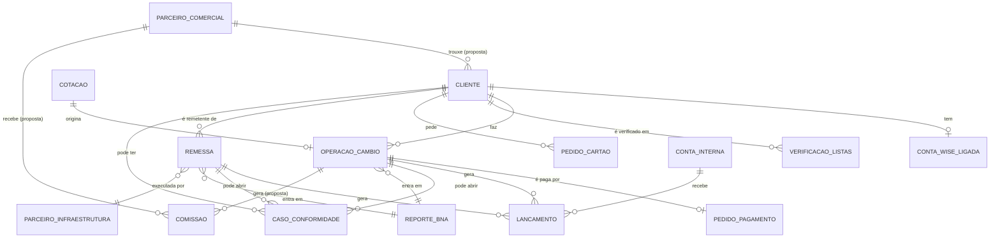

# 09. Modelo de dados

**Estado: Proposta de organização**, baseada no que as versões anteriores já tinham (ledger de dupla entrada, contas, remessas, auditoria, taxas, parâmetros de risco, chaves de idempotência) e nas áreas definidas. Sem esquema técnico nesta etapa. Estados e regras estão em `10-regras-financeiras.md`.

## Entidades
| Entidade | O que guarda | Estado |
| --- | --- | --- |
| Cliente | Nome, documento de identificação, estado de verificação, nível de risco, origem (parceiro) | Confirmado. Origem: Proposta |
| Cliente de balcão ocasional | Ficha simples de identificação | Proposta |
| Utilizador interno | Pessoa da equipa, perfil, estado | Perfis: Proposta |
| Perfil e permissão | Funções e o que cada uma pode fazer | Proposta |
| Conta Wise ligada | Ligação do cliente à sua conta Wise, autorização, estado | Confirmado (Condicionado) |
| Parâmetro de taxa | Taxa de referência e margens de compra e venda por moeda | Confirmado |
| Cotação | Taxa aplicada, valor a receber, validade de 90 s, estado | Confirmado |
| Operação de câmbio | Cliente, canal (balcão ou digital), moeda, valores, tipo e sentido, estado | Confirmado |
| Pedido de pagamento | Método, valor, referência, estado, identificação do pagador | Confirmado |
| Remessa | Remetente, beneficiário, valor, parceiro, estado | Confirmado |
| Parceiro de infraestrutura | Ficha do parceiro (Wise, pagamentos, remessas, listas), estado | Confirmado |
| Conta interna | Contas de liquidação, comissões, contrapartida, e por moeda | Confirmado |
| Lançamento contabilístico | Movimento imutável de débito e crédito, ligado à operação | Confirmado |
| Verificação de listas | Resultado de sanções e PEP, data, correspondências | Confirmado |
| Caso de conformidade | Alerta, gravidade, estado, decisão, notas, operação ligada | Confirmado |
| Reporte ao BNA | Mapa do dia (câmbio e remessa), estado de submissão, data e hora | Confirmado |
| Pedido de cartão | Tipo (digital ou físico), estado, chegada, levantamento, ativação | Confirmado. Registos de chegada e levantamento: Proposta |
| Evento de auditoria | Quem, o quê, quando, valor anterior e novo | Confirmado |
| Chave de idempotência | Impede repetição de pagamentos, remessas e eventos externos | Confirmado |
| Parâmetro de risco | Limites de revisão, bloqueio, velocidade, fracionamento | Confirmado (valores pendentes) |
| Parceiro comercial | Dados, nível, estado, documentos | **Proposta** |
| Pedido ao parceiro | Pedido de apoio de um cliente | **Proposta** |
| Comissão | Base, valor, estado (a apurar, confirmada, paga) | **Proposta** |
| Pedido de apoio e reclamação | Assunto, responsável, prazo, resposta | **Proposta** |

## Relações principais

## Regras de dados
1. Lançamentos e eventos de auditoria **nunca** se alteram nem se apagam.
2. Saldos são derivados dos lançamentos e verificados contra eles.
3. Documentos de identidade ficam fora da base principal (ver `08`).
4. Cada entidade tem identificador próprio, data de criação e autor.
5. Dados reais nunca saem de produção. Os outros ambientes usam dados fictícios.
