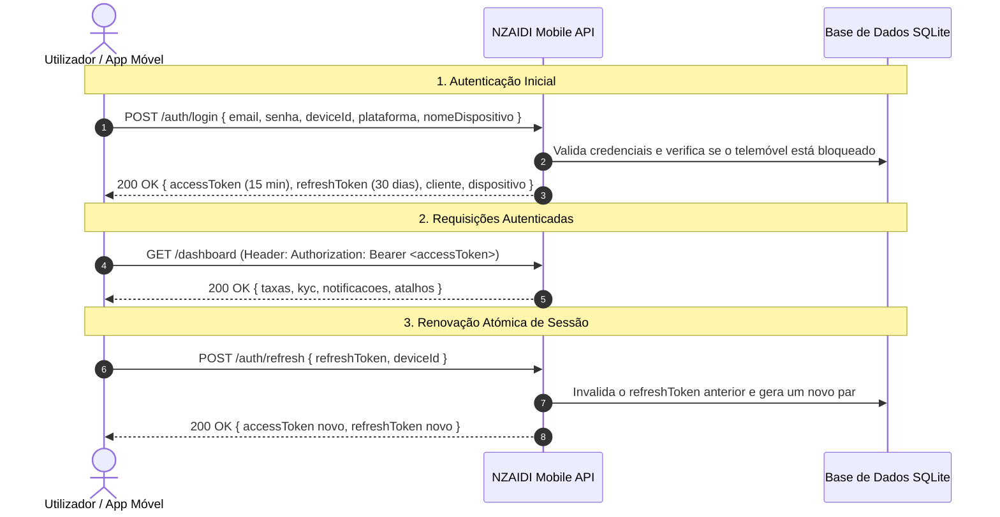

# NZAIDI Mobile — Pacote Oficial de Integração (Google AI Studio)

Este documento constitui o guia mestre de integração técnica e arquitetural da aplicação móvel oficial **NZAIDI Mobile** (Android e iOS), desenvolvida externamente no Google AI Studio, conectando-se diretamente à API central Fastify do sistema financeiro da **NZAIDI – Casa de Câmbios & Transferência, Lda.** (Luanda, Angola).

---

## 1. URLs Base e Ambientes de Execução

| Ambiente | URL Base | Finalidade e Políticas |
| :--- | :--- | :--- |
| **Homologação (Dev/Testes)** | `https://homolog-api.nzaidi.ao/api/v1/mobile` | Ambiente isolado com base de dados SQLite dedicada. Seguro para simulações e desenvolvimento da app móvel. |
| **Local (Emulador Android)** | `http://127.0.0.1:3000/api/v1/mobile` | Endereço do host local no emulador oficial do Android Studio. |
| **Local (Simulador iOS)** | `http://localhost:3000/api/v1/mobile` | Endereço local no simulador iOS (Xcode). |
| **Local (Dispositivo Físico)** | `http://<IP_DA_REDE_LOCAL>:3000/api/v1/mobile` | Wi-Fi na mesma sub-rede da máquina de desenvolvimento. |
| **Produção (Oficial Luanda)** | `https://app.nzaidi.ao/api/v1/mobile` | **ESTRITAMENTE RESTRITO**: Nenhuma chave ou teste deve ser apontado para produção sem homologação prévia. |

> [!IMPORTANT]
> A especificação OpenAPI 3.1.0 completa e validada encontra-se no ficheiro [`openapi.yaml`](./openapi.yaml).

---

## 2. Cabeçalhos Obrigatórios (Android e iOS)

Todas as requisições enviadas pela aplicação móvel para a API NZAIDI **devem** incluir os seguintes cabeçalhos HTTP para assegurar telemetria, segurança antifraude e rastreabilidade:

| Cabeçalho | Tipo | Obrigatório | Exemplo Android | Exemplo iOS | Descrição |
| :--- | :--- | :--- | :--- | :--- | :--- |
| `x-device-id` | `string` | **Sim** | `357281092837461` | `9B82C10D-57F1-4F2A` | Identificador único e persistente do telemóvel (`android_id` ou `identifierForVendor`). |
| `x-platform` | `string` | **Sim** | `android` | `ios` | Plataforma do sistema operativo (**sempre minúsculas**). |
| `x-app-version` | `string` | **Sim** | `1.0.0` | `1.0.0` | Versão semântica da aplicação instalada. |
| `x-os-version` | `string` | Não | `Android 14` | `iOS 17.5.1` | Versão do sistema operativo. |
| `x-device-name` | `string` | Não | `Samsung Galaxy S24` | `iPhone 15 Pro` | Nome comercial legível do modelo do aparelho. |
| `x-push-token` | `string` | Não | `fcm_token_xyz...` | `apns_token_abc...` | Token para receção de notificações push via FCM ou APNs. |
| `x-correlation-id` | `string` | Não | UUID v4 | UUID v4 | Identificador único da transação gerado no app para rastreio ponta a ponta. |

---

## 3. Arquitetura de Autenticação e Sessão

O sistema utiliza um modelo de autenticação de dupla chave: **Access Token JWT de curta duração** acompanhado de **Refresh Token rotativo atómico**.



### Regras de Segurança dos Tokens:
1. **Access Token (JWT)**:
   - Duração: **15 minutos** (`expiresInSeconds: 900`).
   - Algoritmo: HMAC-SHA256 assinado institucionalmente.
   - Envio: Cabeçalho `Authorization: Bearer <accessToken>`.
2. **Refresh Token (Rotativo Atómico)**:
   - Duração: **30 dias**.
   - **Rotação Obrigatória**: Cada chamada a `/auth/refresh` consome e invalida imediatamente o token enviado, devolvendo um novo. Se um token já revogado for utilizado, a API deteta tentativa de furto de sessão e bloqueia todas as sessões ativas do telemóvel por precaução de segurança.
3. **Terminar Sessão**:
   - `POST /auth/logout`: Revoga apenas a sessão do telemóvel atual.
   - `POST /auth/logout-global`: Revoga todas as sessões ativas do cliente em todos os dispositivos.

---

## 4. Endpoints Organizados por Módulo

### 4.1. Módulo de Autenticação e Acesso
- `POST /auth/login`: Autentica cliente e regista telemóvel.
- `POST /auth/refresh`: Rotação atómica de sessão.
- `POST /auth/logout`: Termina sessão local.
- `POST /auth/logout-global`: Termina todas as sessões do cliente.
- `POST /auth/recuperar-senha`: Solicita código OTP por e-mail.
- `POST /auth/redefinir-senha`: Redefine palavra-passe com o código OTP de 6 dígitos.
- `GET /auth/dispositivos`: Lista todos os telemóveis do cliente.
- `DELETE /auth/dispositivos/{id}`: Revoga acesso de um telemóvel específico.
- `POST /dispositivos/push-token`: Atualiza o token FCM/APNs do dispositivo ativo.

### 4.2. Módulo de Perfil e Conformidade (KYC)
- `GET /cliente/perfil`: Devolve dados pessoais, morada, profissão e métricas da conta.
- `PUT /cliente/perfil`: Atualiza dados permitidos (telefone, email, morada, profissão).
- `GET /cliente/kyc/status`: Devolve nível KYC (*Nível 1, 2 ou 3*), limites diários/anuais e documentos pendentes.
- `GET /cliente/documentos`: Lista os documentos submetidos e o respetivo estado de validação da conformidade (*pendente, valido, invalido*).
- `POST /cliente/documentos`: Submete ficheiro de identificação oficial.

### 4.3. Módulo de Dashboard e Câmbios
- `GET /dashboard`: Ecrã inicial com resumo de saldo, cotações de hoje, atalhos e avisos.
- `GET /taxas`: Taxas oficiais de compra e venda em tempo real para USD e EUR com moeda base AOA.
- `GET /cambio/moedas`: Moedas transacionadas e respetivas regras.
- `POST /cambio/simular`: Simulação de contravalor em Kwanzas antes da confirmação.
- `GET /cambio/pedidos`: Histórico de pedidos cambiais do cliente.
- `POST /cambio/pedidos`: Submissão de pedido de câmbio online com método de pagamento selecionado (*MULTICAIXA_EXPRESS, REFERENCIA_MULTICAIXA, TRANSFERENCIA_BANCARIA, BALCAO*).

### 4.4. Módulo de Remessas Internacionais
- `GET /remessas/paises`: Lista de países de destino suportados (*Portugal, Espanha, Brasil, EUA, etc.*) e moedas de entrega.
- `GET /remessas/pedidos`: Histórico de transferências para o exterior.
- `POST /remessas/pedidos`: Criação de pedido de envio internacional com beneficiário, IBAN/SWIFT e finalidade regulamentar.

### 4.5. Módulo de Cartões Visa Virtuais (StroWallet)
- `GET /cartoes`: Lista de cartões virtuais emitidos e estado da conta.
- `GET /cartoes/status`: Estado do serviço bancário (atualmente em homologação regulamentar BNA).
- `POST /cartoes/lista-espera`: Registo do cliente na lista de espera prioritária para atribuição de cartão.

### 4.6. Módulo de Notificações e Push (FCM / APNs)
- `GET /notificacoes`: Lista de notificações do cliente com contador de não lidas.
- `PATCH /notificacoes/{id}/lida`: Marca uma notificação como lida.
- `POST /notificacoes/ler-todas`: Marca todas as notificações como lidas.

---

## 5. Formato de Carregamento de Documentos e Fotografias (Uploads)

A API aceita ficheiros codificados em **Base64** através do endpoint `POST /cliente/documentos`:

```json
{
  "tipoDocumento": "bi",
  "numeroDocumento": "DOC-EXEMPLO-001",
  "nomeArquivo": "documento_bi_frente_verso.pdf",
  "mimeType": "application/pdf",
  "arquivoBase64": "JVBERi0xLjQKJ..."
}
```

### Regras Estritas de Validação de Ficheiros:
1. **Tipos de Documento Válidos**: `bi` (Bilhete de Identidade), `passaporte`, `cartao_residente`, `nif_empresa`.
2. **Formatos Binários Aceites**: `application/pdf`, `image/png`, `image/jpeg`.
3. **Limite de Tamanho**: Máximo de **5 MB** por ficheiro.
4. **Verificação de Magic Bytes**: A API inspeciona os primeiros bytes binários do ficheiro para confirmar que o conteúdo corresponde exatamente à extensão declarada (prevenindo ficheiros corrompidos ou executáveis mascarados).
5. **Cálculo de Hash SHA-256**: É gerado um hash criptográfico registado na tabela de auditoria para garantir a integridade legal do documento.

---

## 6. Tratamento de Erros e Padrão de Resposta

Todas as respostas da API seguem um formato JSON previsível:

### Resposta de Sucesso (HTTP 200 / 201)
```json
{
  "sucesso": true,
  "mensagem": "Operação executada com sucesso.",
  "dados": { ... }
}
```

### Resposta de Erro (HTTP 400, 401, 403, 404, 422, 429, 500)
```json
{
  "sucesso": false,
  "erro": "A palavra-passe introduzida está incorreta.",
  "codigo": "AUTH_CREDENCIAIS_INVALIDAS",
  "detalhes": null
}
```

### Tabela de Códigos de Erro Comuns:

| Código HTTP | `codigo` Interno | Significado | Ação Recomendada na App Móvel |
| :--- | :--- | :--- | :--- |
| `401` | `AUTH_TOKEN_EXPIRADO` | Access token JWT expirou | Chamar automaticamente `/auth/refresh` em segundo plano |
| `401` | `AUTH_REFRESH_INVALIDO` | Refresh token inválido ou reutilizado | Limpar tokens locais e redirecionar para o ecrã de Login |
| `401` | `DISPOSITIVO_BLOQUEADO` | Telemóvel bloqueado por segurança | Apresentar ecrã de bloqueio com contacto do Compliance |
| `422` | `APP_VERSAO_OBSOLETA` | Versão da app inferior à permitida | Apresentar diálogo forçando atualização na Play Store / App Store |
| `429` | `RATE_LIMIT_EXCEEDED` | Excedido limite de requisições | Apresentar aviso de "Muitas tentativas. Aguarde 1 minuto." |

---

## 7. Integração de Notificações Push (FCM e APNs)

1. **Obtenção do Token**: Ao inicializar a aplicação, obter o push token via Firebase Cloud Messaging (Android) ou Apple Push Notification service (iOS).
2. **Envio no Login**: Passar o token no corpo do login (`tokenPush`) ou no cabeçalho `x-push-token`.
3. **Atualização Dinâmica**: Se o sistema operativo renovar o token push durante a sessão, a app deve chamar:
   ```http
   POST /api/v1/mobile/dispositivos/push-token
   Authorization: Bearer <accessToken>
   Content-Type: application/json

   {
     "pushToken": "fcm_token_ou_apns_token_atualizado"
   }
   ```
4. **Armazenamento**: O token fica associado ao dispositivo na tabela `dispositivos_moveis.token_push`, permitindo à NZAIDI enviar alertas transacionais quando uma remessa for executada, um câmbio for aprovado ou um documento for validado.

---

## 8. Procedimentos para Testar em Homologação sem Afetar a Produção

1. **Ambiente Isolado**: O servidor de testes corre em base de dados separada da produção bancária (`app.nzaidi.ao`).
2. **Contas de Teste**:
   - E-mail: `cliente.teste@nzaidi.ao`
   - Palavra-passe: `Nzaidi2026@Teste`
3. **Simulador de Transações**: Os pedidos criados em homologação não acionam débitos em contas bancárias reais nem reportam dados ao Banco Nacional de Angola.
4. **Verificação de Telemetria**: Todos os pedidos efetuados pelo Google AI Studio podem ser inspecionados em tempo real no Backoffice Administrativo em `#api-gestao/requisicoes`.

---

## 9. Lista de Verificação (Checklist) para a Equipa do Google AI Studio

Antes de iniciar a codificação da aplicação móvel, confirme que dispõe dos seguintes elementos:

- [x] **URL de Homologação Ativa**: `https://homolog-api.nzaidi.ao/api/v1/mobile` (ou URL local de desenvolvimento).
- [x] **Especificação OpenAPI 3.1.0**: [`docs/mobile-api/openapi.yaml`](./openapi.yaml) importada no gerador de código (Swagger / Orval / RTK Query).
- [x] **Cabeçalhos Globais**: Interceptor configurado para injectar `x-device-id`, `x-platform`, `x-app-version` e `x-correlation-id` em todas as requisições HTTP.
- [x] **Armazenamento Seguro de Tokens**: Utilização de `EncryptedSharedPreferences` / `Keystore` (Android) e `Keychain` (iOS) para armazenar o `accessToken` e o `refreshToken`.
- [x] **Interceptor de Auto-Refresh**: Interceptor HTTP que captura status `401`, chama `/auth/refresh` com o `refreshToken` e repete a requisição original de forma transparente para o utilizador.
- [x] **Tratamento de Rate Limit (429)**: Exibição de contagem decrescente amigável em caso de tentativas consecutivas de PIN ou login.
- [x] **Componente de Carregamento de Documentos**: Validador do tamanho de ficheiro (< 5 MB) antes do envio em Base64.
- [x] **Tokens Push (FCM / APNs)**: Registo do `tokenPush` na inicialização da aplicação e escuta de eventos em background.
- [x] **Identidade Visual**: Paleta de cores oficial NZAIDI (*Azul Nobre `#08264F`*, *Dourado Câmbios `#D9A441`*, *Fundo Claro `#F8FAFC`* e tipografia *Sora / Manrope*).
