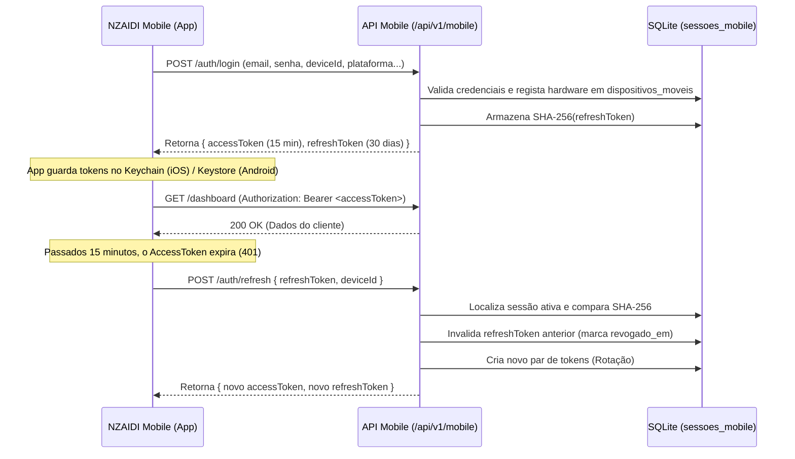

# NZAIDI Mobile — Autenticação e Gestão de Sessões

A arquitetura de segurança do **NZAIDI Mobile** baseia-se num sistema de duplo token (Access Token de curta duração e Refresh Token rotativo com persistência criptográfica SHA-256 e detecção de fraude).

---

## 1. Ciclo de Vida dos Tokens



---

## 2. Detecção de Reúso Malicioso (Token Theft Protection)

Se um `refreshToken` que já foi revogado ou renovado for apresentado novamente à API:
1. O backend assume imediatamente que ocorreu **exfiltração de token** (ataque de roubo de sessão).
2. O backend executa **revogação em cadeia**: todas as sessões ativas daquele dispositivo são instantaneamente invalidadas na base de dados.
3. Um alerta de segurança crítico de nível `alto` é inserido na tabela `mobile_alertas` e exibido no painel de controlo do administrador (`#api-gestao`).
4. A resposta HTTP é `401 Unauthorized` com mensagem de violação de segurança.

---

## 3. Armazenamento Seguro no Dispositivo

| Plataforma | Mecanismo Recomendado | Biblioteca | Proteção |
| :--- | :--- | :--- | :--- |
| **iOS** | Apple Keychain Services | `expo-secure-store` / `react-native-keychain` | Encriptação por hardware com Secure Enclave. `kSecAccessControlBiometryAny`. |
| **Android** | Android Keystore Provider | `expo-secure-store` / `react-native-keychain` | Chaves encriptadas com hardware MasterKey (AES-256-GCM). |

> [!CAUTION]
> **NUNCA** armazene `accessToken` ou `refreshToken` em texto puro (`AsyncStorage` desprotegido, `localStorage` ou variáveis globais).

---

## 4. Endpoints de Autenticação

### 4.1 Iniciar Sessão (Login)
- **Método**: `POST`
- **Rota**: `/api/v1/mobile/auth/login`
- **Acesso**: Público (com rate limit: máx 5 tentativas por minuto por IP/dispositivo)
- **Corpo da Requisição**:
  ```json
  {
    "email": "cliente@exemplo.ao",
    "senha": "PasswordSegura123!",
    "deviceId": "c1f7b822-48e2-45e3-a6d1-d249f80bf11a",
    "plataforma": "android",
    "nomeDispositivo": "Samsung Galaxy S24 Ultra",
    "versaoSo": "14.0",
    "versaoApp": "1.0.0",
    "tokenPush": "fcm_token_opcional_aqui"
  }
  ```
- **Resposta de Sucesso (200)**:
  ```json
  {
    "sucesso": true,
    "mensagem": "Autenticação móvel efetuada com sucesso.",
    "dados": {
      "accessToken": "eyJhbGciOi...",
      "refreshToken": "4a8e2b9c7d1e3f...",
      "tokenType": "Bearer",
      "expiraEmSegundos": 900,
      "cliente": {
        "id": "cli_uuid",
        "nome": "Manuel Fernandes",
        "email": "cliente@exemplo.ao",
        "telefone": "+244923112233",
        "nif": "5001234567",
        "estadoKyc": "aprovado"
      },
      "dispositivo": {
        "id": "disp_uuid",
        "plataforma": "android",
        "status": "ativo"
      }
    }
  }
  ```

### 4.2 Renovar Sessão (Refresh Token)
- **Método**: `POST`
- **Rota**: `/api/v1/mobile/auth/refresh`
- **Acesso**: Público (requer dispositivo registado)
- **Corpo da Requisição**:
  ```json
  {
    "refreshToken": "4a8e2b9c7d1e3f...",
    "deviceId": "c1f7b822-48e2-45e3-a6d1-d249f80bf11a"
  }
  ```
- **Resposta de Sucesso (200)**:
  ```json
  {
    "sucesso": true,
    "mensagem": "Sessão renovada com sucesso.",
    "dados": {
      "accessToken": "eyJhbGciOi...novo",
      "refreshToken": "9d8e1f2a...novo",
      "tokenType": "Bearer",
      "expiraEmSegundos": 900
    }
  }
  ```

### 4.3 Terminar Sessão (Logout Individual)
- **Método**: `POST`
- **Rota**: `/api/v1/mobile/auth/logout`
- **Acesso**: Autenticado (`Authorization: Bearer <token>`)
- **Corpo da Requisição**: `{}`
- **Resposta de Sucesso (200)**:
  ```json
  {
    "sucesso": true,
    "mensagem": "Sessão móvel terminada e credenciais revogadas."
  }
  ```

### 4.4 Encerrar Todas as Sessões (Logout Global)
- **Método**: `POST`
- **Rota**: `/api/v1/mobile/auth/logout-global`
- **Acesso**: Autenticado (`Authorization: Bearer <token>`)
- **Corpo da Requisição**: `{}`
- **Resposta de Sucesso (200)**:
  ```json
  {
    "sucesso": true,
    "mensagem": "Todas as sessões móveis foram revogadas com sucesso."
  }
  ```

---

## 5. Gestão e Bloqueio de Dispositivos

1. **Consulta de Dispositivos**: `GET /api/v1/mobile/dispositivos` — Lista os dispositivos associados à conta com data do último acesso, IP e versão.
2. **Revogação pelo Cliente**: `DELETE /api/v1/mobile/dispositivos/:id` — Permite ao cliente desvincular um smartphone perdido ou antigo.
3. **Bloqueio pelo Administrador**: Na retaguarda (`#api-gestao`), administradores podem revogar acessos ou bloquear dispositivos comprometidos imediatamente.
